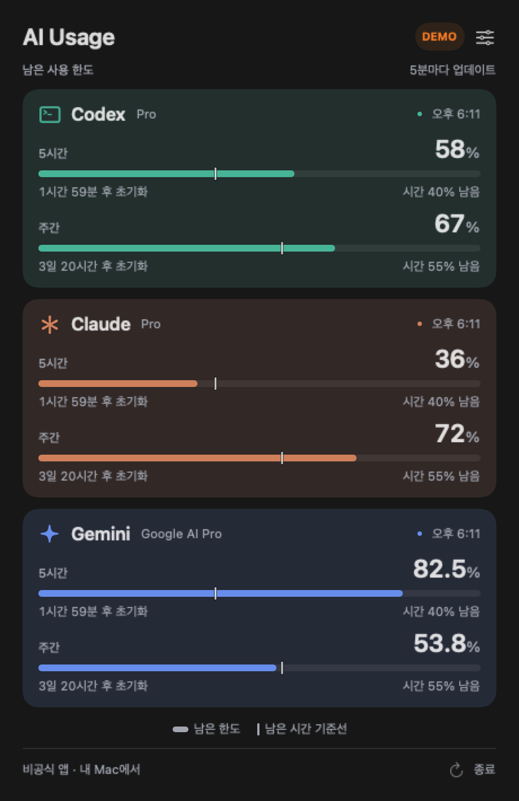

# AI Usage

**Codex·Claude·Gemini의 남은 한도를 Mac 메뉴 막대 한곳에서.**

[English](README.md) · [연결 방법](docs/BRIDGE.md) · [개인정보 처리](docs/PRIVACY.md) · [검증 기록](docs/VERIFICATION-0.3.md)

기존 ChatGPT Usage를 세 서비스용으로 확장한 macOS 앱이다. 서비스별 남은 한도, 초기화까지 남은 시간, 사용 페이스를 비교한다. 각 서비스의 한도는 별개로 표시한다.



화면은 DEMO 예시 데이터다. 실제 계정 세 개의 연결 성공을 뜻하지 않는다.

## 현재 상태

0.3.0 개발 베타. 현재 Mac에서 세 서비스의 실제 연결과 공식 사용량 화면 대조를 마쳤다. 기존 v0.2.1 공개 다운로드는 Codex 전용이다. 새 버전의 실제 연결 검증 범위는 [검증 기록](docs/VERIFICATION-0.3.md)에 구분했다.

- **Codex:** 설치된 Codex의 ChatGPT 구독 로그인으로 조회한다. 일반 ChatGPT 대화 한도·API 비용과는 다르다.
- **Claude:** Claude Code의 실험적 사용량 요청 또는 로그인된 Claude 웹 + 확장으로 연결한다.
- **Gemini:** 로그인된 Gemini 웹 + 확장으로 Gemini 앱 요금제 한도를 읽는다. Argon 사용이 반영될 수 있지만 Argon만의 한도라고 가정하지 않는다. Antigravity 한도와는 구분한다.

메뉴 막대는 **Codex → Claude → Gemini** 순서의 작은 막대 세 개로 표시한다. 채워진 높이는 남은 한도이며, 클릭하면 정확한 수치와 초기화 시간을 확인할 수 있다. 마우스를 올리면 각 막대가 나타내는 기간을 알려 준다(주간 한도가 있으면 우선 표시). 갱신·연결이 필요한 상태는 중간이 끊긴 표시로, 실제 0%는 빈 실선 트랙으로 구분한다.

상세 패널의 색 막대는 남은 한도, 세로선은 남은 시간이다. 막대가 선보다 길면 균등하게 사용하는 기준보다 여유가 있다. 실제 일일 한도가 아닌 참고 기준이다. 연결 실패·오래된 데이터·초기화 시각이 지난 데이터는 표시를 구분한다.

## 설치 및 연결

macOS 14 이상, Apple Command Line Tools의 Swift 5.9 이상이 필요하다. 확장 테스트에는 Node를 사용한다. 앱은 임시 서명 상태이며 Apple 공증을 받지 않았다.

```sh
git clone -b feat/multi-provider-usage https://github.com/Sunjae-L22/chatgpt-usage.git
cd chatgpt-usage
make test
make bundle
open "dist/AI Usage.app"
```

1. Codex에 ChatGPT 계정으로 로그인한다.
2. Chrome의 `chrome://extensions`에서 개발자 모드를 켜고 `압축해제된 확장 프로그램을 로드합니다`로 `browser-extension` 폴더를 선택한다.
3. 앱 설정의 **연결 키 복사** → 확장에 붙여 넣고 연결한다.
4. [Claude 사용량](https://claude.ai/settings/usage)과 [Gemini 사용량](https://gemini.google.com/usage)을 원하는 계정으로 열어 둔다.
5. Chrome과 해당 탭이 열려 있으면 확장이 5분마다 조회한다. 웹 한도는 확장에서, CLI 한도는 앱에서 새로고침한다.

앱 설정의 **확장 폴더 보기**로 동봉된 확장을 찾을 수 있다. 불러온 확장 폴더는 계속 같은 위치에 두어야 한다. Chrome 웹 스토어 배포는 아직 하지 않았다.

비밀번호·쿠키를 앱에 복사하지 않는다. 확장이 브라우저의 기존 로그인을 사용해 사용량 요청을 보낸 뒤, 정리한 한도 데이터만 내 Mac의 인증된 로컬 연결로 전달한다. 별도 분석 수집이나 클라우드 중계는 없다.

Windows는 후속 계획이며 아직 구현되지 않았다. 우선 Mac에서 실제 계정 연결과 설치 편의성을 검증한다.

기존 [CodexBar](https://github.com/steipete/CodexBar)에도 여러 서비스 통합 기능이 있다. 이 프로젝트는 세 서비스를 간결하게 비교하는 화면과 공통 페이스 기준에 집중한다. 최초 앱이라고 주장하지 않는다. Codex가 구현과 검증을 도왔다.

MIT 라이선스. OpenAI·Anthropic·Google과 관계없는 비공식 프로젝트다.
