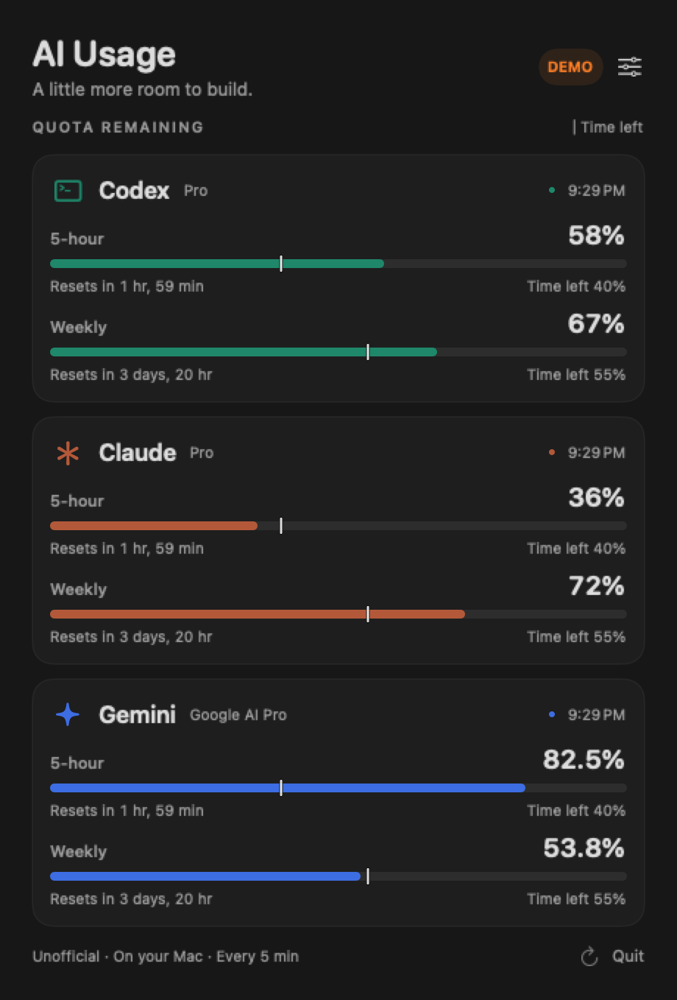

# AI Usage

**Codex, Claude, and Gemini quota — one glance at your Mac menu bar.**

[한국어](README.ko.md) · [Stable Codex-only releases](https://github.com/Sunjae-L22/chatgpt-usage/releases) · [Connections](docs/BRIDGE.md) · [Privacy](docs/PRIVACY.md)

AI Usage expands the original ChatGPT Usage app into a small native macOS dashboard. Compare remaining quota, reset countdowns, and a time pace line across three services. Separate services keep their own quotas; there is no invented combined percentage.



*Sample data, labeled DEMO. This image is not a claim of three live account connections.*

## Status: 0.3.0 development beta

The three-provider app and Chrome extension are implemented; all three connections have been verified on the author’s Mac against real account data. See [verification](docs/VERIFICATION-0.3.md) for the exact live checks. The older v0.2.1 download remains Codex-only until a new release is published. This is an unofficial project; provider protocols can change.

| Service | What the app reads | Connection |
|---|---|---|
| Codex | Subscription quota associated with your ChatGPT login | Installed Codex app-server |
| Claude | Claude plan windows and supported model-specific windows | Claude Code experimental usage protocol, or signed-in Claude website + extension |
| Gemini | Gemini app plan windows, including usage of Argon | Signed-in Gemini website + extension |

Ordinary ChatGPT chat caps, API spending, token counts, and Antigravity quotas are outside this display. A Gemini app quota is not necessarily an Argon-only quota.

## At a glance

- A fixed-width menu icon with three mini bars, ordered Codex → Claude → Gemini. Height shows remaining quota; click for exact values and reset times. Hover names the represented window (weekly when available).
- Broken neutral marks mean a refresh or connection is needed; a solid empty track means a measured 0%.
- Three compact service cards; extra model windows expand on demand.
- **Remaining** quota, actual reset countdown, and last update time for each service.
- Colored bar = quota remaining. Vertical line = time remaining in that window.
- If the bar extends beyond the line, you are spending more slowly than an even pace. This is a reference, **not an official daily allowance**.
- Missing data stays unknown. Stale or failed readings are marked; expired windows never silently become 100%.
- Integer Codex data stays integer. Genuine fractional provider data can display one decimal place.
- English/Korean, light/dark appearance, optional launch at login.
- No telemetry, no model turns, no cloud relay. Quota values stay in memory.

## Build and connect

macOS 14+, Apple Command Line Tools with Swift 5.9+. Node is used only for extension tests. No third-party packages are required. The app is ad-hoc signed and not notarized.

```sh
git clone -b feat/multi-provider-usage https://github.com/Sunjae-L22/chatgpt-usage.git
cd chatgpt-usage
make test
make bundle
open "dist/AI Usage.app"
```

1. Sign in to the installed Codex app or CLI with ChatGPT. The app detects current and older desktop bundle layouts.
2. For browser quotas, open Chrome → `chrome://extensions`, enable developer mode, then **Load unpacked** → the `browser-extension` folder. Review its [permissions and code](browser-extension/README.md) first.
3. In AI Usage settings, **Copy pairing key**. Paste it into the extension popup and pair.
4. Open [Claude usage](https://claude.ai/settings/usage) and [Gemini usage](https://gemini.google.com/usage), using the intended account. Keep a signed-in tab for each service open.
5. The extension refreshes every five minutes while Chrome and the pages are open. Its Refresh button refreshes browser sources. The app's Refresh button refreshes local CLI sources.

The extension is bundled inside the app's Resources folder; **Reveal extension** opens it in Finder. Do not delete or move that folder after loading it. It is not published in the Chrome Web Store yet.

The native listener accepts authenticated quota updates only on `127.0.0.1:49627`. No cookies or upstream tokens are copied into the native app. The extension uses the browser's existing session to request each site's quota endpoint. Read [privacy](docs/PRIVACY.md) and the [bridge protocol](docs/BRIDGE.md).

## Development

```sh
make check  # Real Codex quota read; no model prompt
.build/direct/ChatGPTUsage --render-demo /tmp/ai-usage.png --language en
.build/direct/ChatGPTUsage --render-demo /tmp/ai-usage-light.png --language ko --light
```

`Sources/UsageCore` normalizes provider snapshots; `Sources/ChatGPTUsage` renders the Mac UI and receives browser updates; `browser-extension` reads provider-specific quota endpoints. The JSON bridge and parsers can be reused in a future Windows app. **There is no Windows app yet.**

## Why this project?

[CodexBar](https://github.com/steipete/CodexBar) already supports multiple services. This project focuses on three services, a simple shared pace display, and Korean/English UI. It is not the first quota monitor. Its Gemini endpoint research benefited from CodexBar's published implementation; see [acknowledgments](docs/ACKNOWLEDGMENTS.md).

The original project was inspired by using Claude Usage Tracker. Codex assisted with implementation and verification. The [original development story](https://it-study-2002.tistory.com/entry/chatgpt-usage-codex-macos) describes the earlier Codex-only version.

Feedback on account window shapes and setup friction is welcome. Never attach cookies, pairing keys, raw account responses, or personal screenshots to an issue.

MIT licensed. Independent project, not affiliated with OpenAI, Anthropic, or Google.
